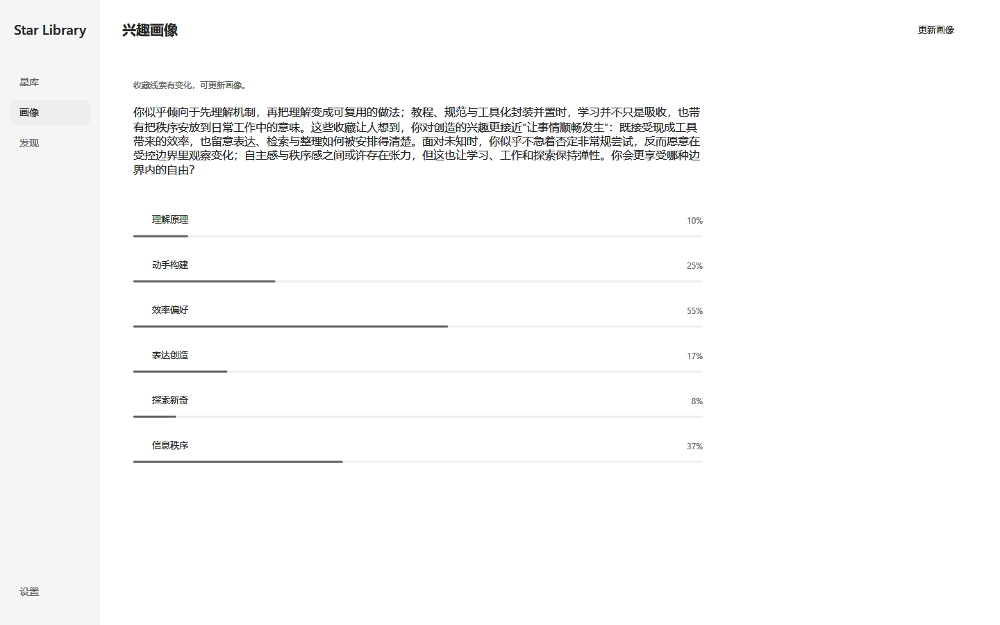
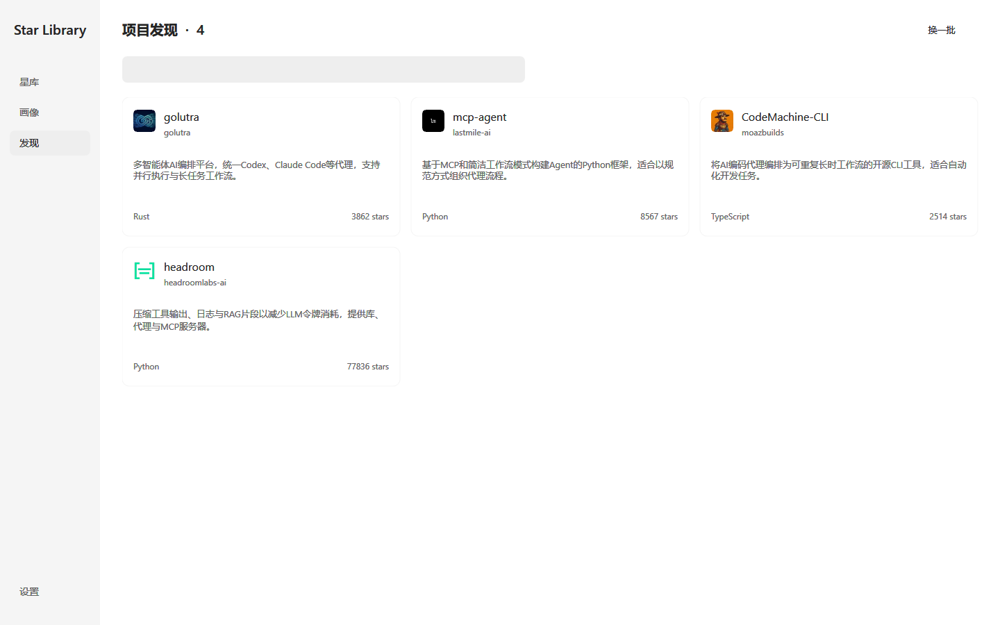

# Star Library

**300 多 KB 的单文件 AI 星库。** 管理 GitHub Stars，用中文概括看懂项目，从收藏中认识自己的兴趣，再发现值得尝试的新项目。

[下载 Windows x64](https://github.com/liuminxin45/star-library/releases/latest/download/StarLibrary.exe) · [介绍页](https://www.liuminxin.cn/works/star-library) · [MIT](LICENSE)

- **小巧原生**：Windows 10/11，单 exe，免安装，无额外运行环境。
- **AI 整理**：按预算批量生成中文概括，成功逐项保存，只补试未完成项目。
- **兴趣画像与发现**：向内探索的叙事、六种兴趣倾向。按真实收藏主题寻找至少 100 Stars 的实用工具，结合热度与“不感兴趣”反馈精选。
- **数据在本地**：离线浏览、自动保存、JSON 导入导出，免费开源。

GitHub 同步和 Star / Unstar 需要 Token。AI 使用自行配置的 Chat Completions 服务，可能产生服务费用；相关公开及私有项目元数据会发送给该服务。

有新版本时，设置页显示“更新”并跳转 Release；“★ Star me”可打开并 Star 本项目，已 Star 时不会重复写入。

## 真实运行截图






## 构建

安装 VS2022 C++ 桌面开发工具与 Windows SDK，然后执行：

```powershell
.\build.cmd -Architecture x64 -Test
```

产物为 `StarLibrary.exe`，不超过 1,000,000 字节。[完整构建、测试与使用说明](docs/build-and-usage.md)。

JSON 使用 [yyjson](https://github.com/ibireme/yyjson)；界面参考 [ChatGPT-Desktop-UI](https://github.com/liuminxin45/ChatGPT-Desktop-UI)，以 C17 和 Windows 原生绘制实现。
