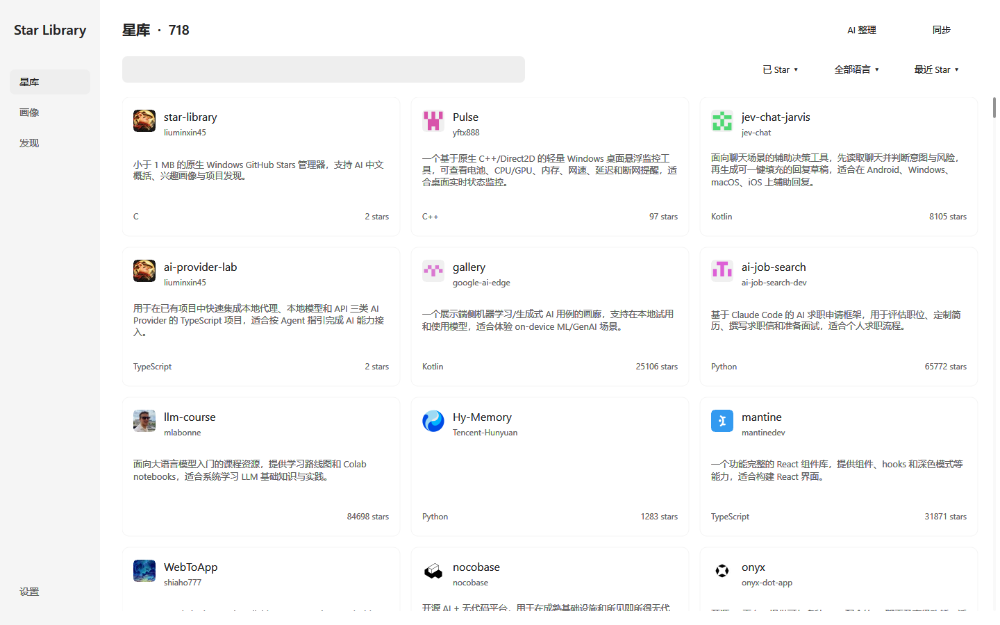

# Star Library

**300 多 KB，单文件 exe，带 AI 的 GitHub Stars 管理器。** 原生 Windows 界面，下载后双击运行：浏览和管理 Stars，用中文概括看懂项目，从收藏中生成兴趣画像，再发现值得尝试的项目。AI 接入你自己的模型服务，不内置模型。

[下载 Windows x64 单文件程序](https://github.com/liuminxin45/star-library/releases/latest/download/StarLibrary.exe) · [版本发布](https://github.com/liuminxin45/star-library/releases) · [MIT License](LICENSE)

## 能力

- **Star 管理**：使用 Token 连接 GitHub，识别账号、同步 Stars，在应用内 Star / Unstar。支持卡片浏览、搜索、语言筛选和排序，点击项目直接打开 GitHub。
- **中文 AI 概括**：把项目作用整理成一句中文，优先展示有效概括，否则保留原始 About。支持批量处理、单项目重新概括、1 / 5 / 10 路并发、逐项保存与失败续接；没有资料的项目正常跳过。
- **认识自己的兴趣**：基于真实收藏证据生成第二人称叙事和六种兴趣倾向。理解原理、动手构建、效率偏好、表达创造、探索新奇、信息秩序的比例由程序计算，可查看具体项目依据。收藏反映兴趣，不等于专业能力。
- **分类进度可续接**：分类结果逐项目保存；遗漏、重复 ID、无效维度只影响对应项目，其余继续处理。再次分析复用资料未变化的分类，叙事失败也不会丢掉分类进度。
- **发现下一件想试的东西**：根据现有画像，从真实 GitHub 候选中精选最多 6 项，兼顾贴近兴趣和相邻领域，支持直接 Star 与“不感兴趣”反馈。
- **本地浏览与数据管理**：离线浏览已同步收藏，支持 JSON 导入导出、自动备份、深浅主题、键盘操作与后台头像缓存。设置修改自动保存。

## 优势

- **单 exe、体积小**：发布构建限制在 1,000,000 字节以内，下载后双击运行。
- **运行环境简单**：面向 Windows 10/11 x64，不需要 Node、Python、WebView2、Electron、浏览器或本地服务。
- **原生界面**：C17 + Win32 + Direct2D + DirectWrite，使用 Windows 自带网络、字体和图片能力，不嵌入 Web 页面。
- **AI 服务可配置**：兼容 Chat Completions，接口可填写服务地址、版本前缀或完整地址，自动补齐路径。可使用云端模型，也可连接本机兼容服务；软件不内置模型。
- **减少重复调用**：概括与分类以项目资料指纹判断是否需要更新，普通同步、Stars 数量或外观变化不会触发全部重做。
- **数据留在本机**：收藏、画像和配置保存到本地，凭据使用 Windows DPAPI 加密。手动执行同步、AI 整理、画像或发现才发起相应 API 请求；头像按需加载并缓存。AI 操作会把公开及私有项目元数据发送至你配置的模型服务。

## 真实运行截图

以下为实际星库数据在原生程序中的运行截图，不使用示例仓库或演示画像。个人数据与凭据不随源码分发。



## 构建方法

### 环境

- Windows 10/11。
- Visual Studio 2022 或 Build Tools，安装“使用 C++ 的桌面开发”及 Windows SDK。项目源码为 C17，使用 MSVC 的 C 编译器。
- Git，用于获取源码。依赖源码已固定版本并包含在仓库中，不需要额外下载包。

### 构建 x64

在 PowerShell 中执行：

```powershell
git clone https://github.com/liuminxin45/star-library.git
cd star-library
.\build.cmd -Architecture x64 -Test
```

产物为 `build\x64\StarLibrary.exe`，同时更新项目根目录的 `StarLibrary.exe`；使用 `-NoInstall` 可只构建、不替换根目录程序。仅需分发这一个 exe。构建脚本会检查 1 MB 体积门槛及 DLL 依赖，拒绝额外的可分发运行库依赖。

可选构建 x86：

```powershell
.\build.cmd -Architecture x86 -Test -NoInstall
```

默认不指定架构时构建 x64，并在成功后更新项目根目录 exe；使用 `-NoInstall` 可保留正在使用的根目录程序。

### 原生 UI 检查

```powershell
$app = Start-Process .\build\x64\StarLibrary.exe `
  -ArgumentList '--ui-test', 'ui-results.txt' -PassThru -Wait
Get-Content .\ui-results.txt
if ($app.ExitCode -ne 0) { throw 'UI checks failed' }
```

核心与 UI 自动测试使用隔离数据和模拟接口，不调用真实模型或修改 GitHub Stars。`scripts\verify-ui.ps1` 可生成固定演示数据的视觉回归截图，与上面的真实运行截图区分。

### GitHub Actions 发布

推送到 `main` 或创建 Pull Request 时，GitHub Actions 自动构建 x64、运行核心与原生 UI 检查，并提供构建产物。

推送版本标签（例如 `0.0.1`）后，同一工作流在 GitHub 上重新构建和测试，检查 x64 架构、exe 版本、1 MB 上限及系统 DLL 依赖，通过后自动创建 Release，附带 **StarLibrary.exe** 和 **SHA256SUMS.txt**。版本标签须与源码及资源版本一致。

## 开始使用

1. 下载 exe，双击打开。
2. 在设置中填写 GitHub Token，点击“连接 GitHub”；“获取 Token”可直接前往 GitHub。需要 Starring 读写、Metadata 读取权限，应用不通过实际 Star 操作探测写权限。
3. 回到星库点击“同步”。已同步项目可离线浏览；所有 GitHub API 操作要求 Token。
4. 配置模型接口、模型名称和 API Key。本机无鉴权模型可以留空 Key。
5. 按需执行“AI 整理”“生成画像”与“换一批”。资料不足不会编造内容；失败或取消后可继续处理剩余项目。

## 数据与快捷键

默认数据目录为 `%USERPROFILE%\.star-library`，包含 `library.json`、备份、加密凭据与头像缓存。固定用户目录避免从打包应用和资源管理器启动时读取到不同的 AppData。

首次升级会检查旧 `%LOCALAPPDATA%\StarLibrary` 和应用包缓存中的旧星库，同账号优先恢复非空、较新版本，保留原文件并复制加密凭据；不同账号不自动合并。现有新目录不会被迁移覆盖。主文件损坏或缺失时，只从通过完整校验的备份恢复，并保留损坏原件；读取或权限错误不会作为空库继续运行。

数据和缓存不计入 exe 大小；头像磁盘缓存上限 20 MiB。断开 GitHub 只清除 GitHub 凭据，保留收藏与模型配置。

```powershell
# 指定独立数据目录
.\StarLibrary.exe --data-dir 'D:\MyStarLibrary'
```

| 快捷键 | 操作 |
| --- | --- |
| Ctrl+1 / 2 / 3 / 4 | 星库 / 画像 / 发现 / 设置 |
| Ctrl+F 或 Ctrl+K | 搜索 |
| Tab / Shift+Tab | 在卡片、操作与输入框间切换 |
| Enter / Space | 执行当前操作 |
| ↑ / ↓、PageUp / PageDown | 滚动 |
| F5 | 同步；发现页为换一批 |

## 许可与致谢

项目采用 [MIT License](LICENSE)。JSON 解析使用 [yyjson](https://github.com/ibireme/yyjson)，保留其 [MIT 许可证](vendor/yyjson/LICENSE) 和固定版本记录。界面参考 [ChatGPT-Desktop-UI](https://github.com/liuminxin45/ChatGPT-Desktop-UI) 的简约风格，使用 Windows 原生绘制实现。
